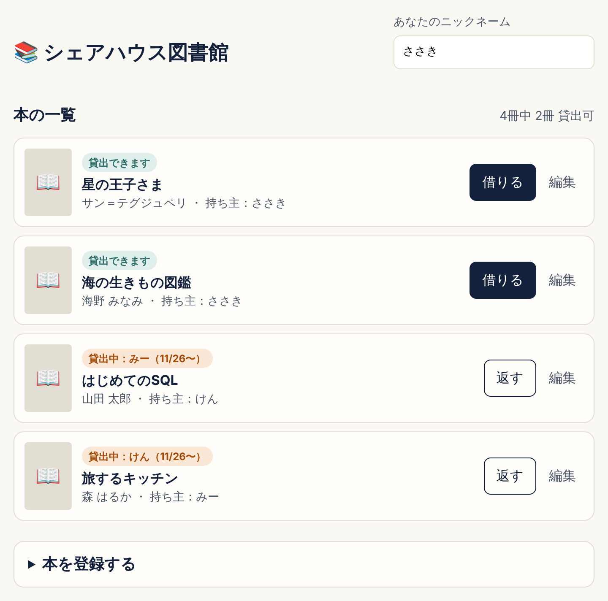

# シェアハウス図書館

シェアハウスの住人が貸している本の一覧と、今借りられるかどうかが分かるWebアプリ。
Cloudflare Workers ＋ D1 の無料枠だけで動きます（クレジットカード登録は不要）。



<sub>※ 画面の本とニックネームはサンプルデータです。</sub>

## なぜ作ったか

シェアハウスでは住人どうしで本を貸し借りしていますが、「あの本は今だれが持っているか」「借りられるか」が分からず、そのたびに聞く必要がありました。
そこで、本の一覧と貸出状況を一目で確認でき、ボタン1つで「借りる」「返す」を記録できるサイトを作りました。

あわせて、次のことを試すための勉強・趣味のプロジェクトでもあります。

- **費用0円で運用する**：Cloudflareの無料枠だけで動かし、どのサービスにもカードを登録しない。無料枠を超えたら止まるだけ
- **AIに頼むだけで本番まで反映する**：Claude Codeに「〇〇を追加して」と頼むと、PR作成 → CI（型チェック・テスト・ビルド）→ 自動マージ → 本番デプロイまで人の手を介さずに進む
- **小さく安全に公開する**：ログインはなし。代わりに検索エンジンに載せない、本名ではなくニックネームで表示する、データはD1のTime Travelで戻せる、という最低限の守りを最初から入れている

## できること

- 本の一覧（貸出できる／貸出中がひと目で分かり、貸出中なら借りている人のニックネームも出る）
- 「借りる」「返す」ボタン（返すときは押し間違い防止の確認あり）
- 本の登録（ISBNを入れるとタイトル・著者・表紙を自動入力）、編集、削除
- 貸出の記録は返却後も削除後も残す

## 構成

| 役割 | 使っているもの |
| --- | --- |
| ホスティング・API | Cloudflare Workers ＋ [Hono](https://hono.dev/) |
| データベース | Cloudflare D1（SQLite） |
| 画面 | HTML・CSS・素のJavaScript（ビルド不要） |
| テスト・CI | Vitest ＋ `@cloudflare/vitest-plugin`、GitHub Actions |
| デプロイ | Cloudflare Workers Builds（mainへのマージで本番反映） |

ここから下は、自分で動かす人向けの手順です。

## 最初の準備（1回だけ）

### 1. GitHub

1. 公開（Public）でリポジトリを作り、コードを置く（済）
   ※ 無料プランで自動マージとブランチ保護を使うには公開が必要。住人の情報はD1にだけ入る
2. **Settings → General → Pull Requests** で「Allow auto-merge」にチェック（済）
3. **Settings → Branches（または Rules → Rulesets）** で `main` にルールを追加
   - 「Require a pull request before merging」をオン
   - 「Require status checks to pass」をオンにして、チェック名 `test` を必須にする（済）
4. [Claude GitHub App](https://github.com/apps/claude) をこのリポジトリにインストール（済）

### 2. Cloudflare（カード登録なし）

1. Cloudflareのアカウントを作る
2. **ストレージとデータベース → D1** で `sharehouse-library` という名前のデータベースを作る（済）
3. 表示された **データベースID** を `wrangler.jsonc` の `database_id` に貼り付けて、GitHubに反映する（済）
4. **Workers & Pages → 作成 → Gitリポジトリをインポート** でこのリポジトリを選ぶ
   - デプロイコマンド：`npm run deploy`
   - 「main以外のブランチのビルド」をオンにすると、PRごとにプレビューURLが届く
5. デプロイが終わると `https://sharehouse-library.<あなたのサブドメイン>.workers.dev` で開ける

## 普段の使い方（AIに頼むだけ）

Claudeアプリの Code タブでこのリポジトリを選び、「〇〇を追加して」と頼む。
→ Claude Codeが `claude/` ブランチでPRを作る → CIが通ると自動マージ → Cloudflareが本番に反映。

## 手元で動かす場合

```sh
npm ci
npm run db:migrate:local   # 初回だけ。ローカルDBにテーブルを作る
npm run dev                # http://localhost:8787
npm test                   # テスト
```
